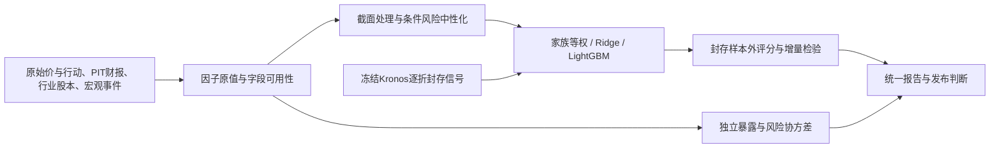

# 原生多因子工作流

在当前`research`中自动执行；`--no-multifactor`可跳过。日频股票相对收益研究是主任务，小时Kronos方向是独立任务。所有实现随skill复制，Python/NumPy/LightGBM在本包环境运行。Qlib、MCP或在线模型服务不参与执行。

## 数据、信号和风险



- 原始因子33项：价格14、财务/规模15、宏观4。显示指标另列。新增`size_log`、`bp`、`roe_ttm`、`asset_growth_yoy`见[因子目录](factor-catalog.md)。
- `features/financial.py`按公开时点取版本，TTM优先同concept/单位的年度＋本期YTD−上年同期YTD，并保留连续四季合计与差额；没有本年年报时也可由累计事实拆Q1/Q2/Q3。以截止原始价、已披露时点股数和拆股统一得到市值估计。同比选择周年前后14天内最近的已知同期，兼容52/53周财年；缺同期不退回上一季度。EPS加权平均股数不能代替时点股数。公开时刻复算相同并不证明来源与全历史皆已验收。
- 当前个股历史分位只用截止前126日价格因子，排除当前观察；原值排序含半个平局计数，样本少于20不显示。它是描述位置，不是上涨概率，不是截面alpha，也不增加独立样本数。财务历史分位尚未建立。
- `prepare_cross_section`每日期独立MAD去极值/缩放，保留缺失；不跨股票/日期补值。行业/市值中性化须有明确PIT控制、至少两个行业、每行业至少3家、设计矩阵满秩、至少10个残差自由度。默认截面最少20家，可在协议中更改。规模因子自身保留规模暴露，仅去行业；宏观共同行情留在上下文。
- 行业元数据通过`security_metadata`输入：`security_id,effective_from,effective_to,available_at,industry,pit_verified,size_pit_confirmed,source_id`。`pit_verified`表示经证据核实的历史行业；`size_pit_confirmed`需历史价、实际股数与行动证据。日期估计和当前行业不自动升级。缺这些列默认false。
- 分数先按预登记经济方向平均族内因子，再按族等权；默认所有声明家族完整覆盖，明确输出逐股覆盖。正负方向是待验证假设。没有规模/质量资料时，不把剩余技术因子重新计权并冒充完整多因子评分。

## 独立风险层

`import-factors`解析已授权的本地Ken French FF3+RF与Momentum日CSV/ZIP，明确从百分数转为小数收益，拒绝坏日期/重复/非有限值并识别缺失码。两个档案按日期一对一合并并保存哈希，不联网下载、不随模型ZIP分发。

`risk.py`使用已实现的个股总收益减RF，对市场、SMB、HML、Momentum回归，计算`Σ=BFBᵀ+D`。默认252日共同因子窗口、120日最低重叠、10%向对角线收缩；全部是工程参数。D为特异方差对角矩阵，当前没有完整行业、拥挤或非对角特异风险，须明确范围。模型是研究归因实现，保留实际因子末日，不能称作商业Barra成品或预计收益。美股FF因子不自动用于港股。

最新版本公共因子收益缺逐期发布时间时只用于事后风险归因。预测训练禁止使用待预测区间已经实现的因子收益。`strict_pit=True`会拒绝未知可知时间。宏观已保存载荷可展示统计期和vintage，但缺真实发布时间的观测不进入历史预测特征。

## 历史合成实验

```powershell
python scripts/skill.py build-dataset --root MY-DATA --market US --tickers NVDA,AAPL,MSFT,AMZN,GOOGL,META,TSLA --benchmark SPY --start 2015-01-02 --end 2025-12-31 --horizons 20 --targets excess --factors mom_60,rv_20,ep_ttm,roa_ttm,size_log --protocol multifactor-protocol.json
python scripts/skill.py multifactor-study --root MY-DATA --market US --horizon 20 --target excess --factors mom_60,rv_20,ep_ttm,roa_ttm,size_log --protocol multifactor-protocol.json
```

示例起止为已发生历史范围，并不表示该库已经获取。协议中因子列表/顺序、市场/目标、时间块必须匹配构建数据。训练/开发/校准/测试共同日期边界覆盖所有股票，收益以下一交易日开盘到第H日收盘起算，不能用完整当日日线预测当日开盘交易结果。

协议包含原有8个区间字段，另有可选`multifactor_candidates`、`ridge_grid`、`lightgbm_grid`、`factor_directions`、`factor_groups`、`selection_metric`、`embargo_days`、`correlation_threshold`、`bootstrap_resamples`和`dataset_admission`。准入示例为`{"status":"verified_point_in_time","evidence":"字段与版本验收工件路径"}`，兼容`verified`状态和`evidence_paths`列表，也接受带`path`/`locator`的证据结构；布尔通过标志及空容器不算证据。CLI和引擎共用准入声明标准化，该声明不能替代实际验收。缺证据时CLI仅允许显式`--development-only`，记录未验证历史研发范围，始终不激活概率。

1. 重建按日分区并检查实际标签起止/成熟时刻；跨入后续块的标签剔除，缺失保持原计划分母。重复证券日期、混合市场/目标/期限、晚到特征拒绝。数据目录及版本写入实验。
2. 仅训练段计算相关簇，按预登记顺序保留代表；族内相关不会自动多算独立票。候选时训练段拟合填补、缩放与权重，在开发段选择有限预算。Ridge为日期等权的正则化回归，LightGBM为本地CPU树回归；默认比较均值与家族等权控制。
3. 选择指标默认日期等权MSE；Rank IC只在足够截面可计算。预登记`dev_min_prediction_coverage`默认0.9，按原计划开发样本分母核验预测覆盖，低于门槛明确拒选。所有候选与失败保留，因子族消融只用开发段。校准块用于单独诊断，不参与选参。
4. 选定参数后用训练＋开发重拟合，保存变换、Ridge JSON或LightGBM文本模型；`load_candidate`原生重载，不用pickle。LightGBM文件使用LF保存、按SHA核验并由Python读取文本，避免Windows换行及中文路径破坏原生重载。先保存不含真实标签的测试预测及哈希，再保存结果评估。
5. 每日期Rank IC、ICIR、排序分组价差、换手、明示假设成本、方向准确率与覆盖分开。按日期块给不确定区间；重叠多日标签价差不能累计成可执行策略收益。
6. `.holdouts`拒绝本研究目录同一市场/目标/期限/日期/股票测试的重复选择和覆盖，允许读取封存工件。其他目录先前已看过的NVDA数据仍是开发证据，换文件夹不会产生盲测。结果不写入活动概率注册表。

`macro_as_features=true`须有`macro_point_in_time_confirmed`及真实历史版本；原始宏观变量可作条件输入，交互须登记。`kronos_*`特征须`kronos_oof_manifest`证明sealed/out_of_fold/frozen_model及证据，并逐行带输入截止、封存时刻和模型训练截止。当前门禁只接受真实历史时点已经封存的信号。自动逐折生成、今天才真实封存的历史遮蔽回放及其标签揭示证明链尚未实现；不可伪造历史封存时刻来绕过门禁。原始路径票数不是校准方向概率。

## 数据优先级和更先进的扩展

当前源库仅NVDA/SPY登记，经营公司截面为1；另有未验收的AAPL/NVDA长日线。因此当前报告完成原值、部分历史分位、公开报表描述及共同因子归因，截面排名和中性化明示未形成。先用现有SEC扩展七姐妹PIT财务、Tiingo补长行动、ALFRED补发布版本；历史股票池/退市权益、自由流通股/行业、分析师预期、期权、借券和新闻长期档案另补渠道。

设计借鉴[Qlib完整研究流程](https://qlib.readthedocs.io/en/latest/component/workflow.html)与[MSCI风险因子分层](https://www.msci.com/data-and-analytics/factor-investing/equity-factor-models)。更广且合格面板后可比较[条件IPCA](https://doi.org/10.1016/j.jfineco.2019.05.001)、[AlphaForge](https://arxiv.org/abs/2406.18394)、[RD-Agent-Quant](https://arxiv.org/abs/2505.15155)的有限自动研发流程，以及2026年[不确定性调整排序](https://arxiv.org/abs/2601.00593)和[残差深层增强](https://arxiv.org/abs/2610.09613)。这些扩展尚未实现或在本项目验证，不把论文效果移植为当前准确率。

广股票截面需独立研究；七姐妹适合限定股票池训练，不足以验证普遍规模/行业溢价。数据量学习曲线仍以固定历史留出、多个种子和W0/简单控制比较，见[训练方案](kronos-training-plan.md)。方向准确率60%是用户验收目标，不能由增加因子、树或输入长度保证。
